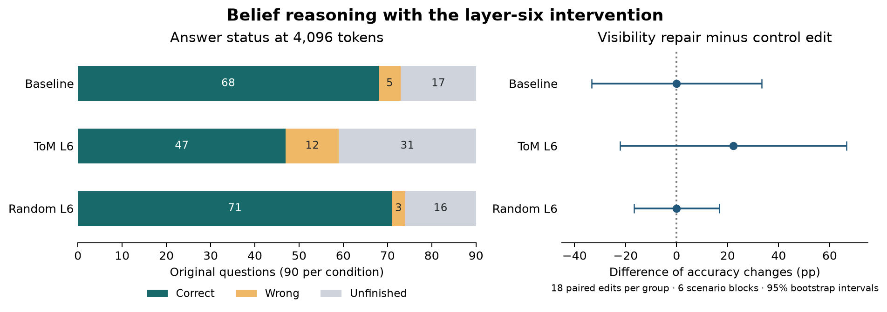

# H100 replication, 8 November 2026

The original 90-item effect replicated on Qwen3.5-9B with prefix caching disabled. The original note reports 75 correct at baseline and 60 with the layer-six ToM intervention. Applying the historical letter extractor to this replication gives 78 and 62. Requiring a finished answer gives 68 and 47. A random direction at layer six gives 71 finished correct answers.

| Condition | Correct final answer / 90 | Finished / 90 | Historical letter score / 90 | Mean generated tokens |
|---|---:|---:|---:|---:|
| None | 68 | 73 | 78 | 1,720 |
| ToM L6 | 47 | 59 | 62 | 2,230 |
| Random L6 | 71 | 74 | 81 | 1,768 |

On the 51 questions both baseline and L6 finished, their scores were 47 and 42. Baseline alone finished 22 more questions, answering 21 correctly. L6 alone finished eight, answering five correctly. These disjoint sets account for the full 21-answer gap: five among mutually completed questions and 16 among asymmetrically completed questions. Conditioning on completion selects different items across arms. The decomposition describes outputs under a fixed 4,096-token budget. It does not estimate performance at unlimited reasoning time.

The matched random comparison gives a similar pattern. L6 and random scored 41 and 46 on the 48 questions both finished. The remaining 19 of their 24-answer gap came from asymmetric completion. Computational replication details include BF16, greedy decoding, thinking enabled, one H100, vLLM 0.33.0, torch 2.14.0+cu130, and model revision `c202236235762e1c871ad0ccb60c8ee5ba337b9a`. The 90 original items and 36 paired rewrites ran together in each 126-request arm. The original checkpoint revision and exact historical software environment were unavailable.



## Wording experiment

Thirty-six of 180 full-benchmark questions explicitly say “Without X seeing” before saying X saw the move. Eighteen appear in the historical 90-item subset. We kept the original data intact and tested a location-only rewrite. A second set of 18 consistent items underwent a comparable wording edit. Each comparison preserves the question, choices, answer and six scenario blocks.

| Condition | Conflicting cue: original → repaired | Consistent cue: original → rewritten | Difference of changes, scenario-bootstrap 95% interval |
|---|---:|---:|---:|
| None | 13 → 14 | 16 → 17 | 0 pp [−33, +33] |
| ToM L6 | 4 → 6 | 8 → 6 | +22 pp [−22, +67] |
| Random L6 | 13 → 15 | 16 → 18 | 0 pp [−17, +17] |

Each count has denominator 18. The L6 direction of change merits a larger test. Its interval includes zero, and only seven of the 18 repaired L6 items finished. The repair did not restore workflow-length reasoning on this sample. The six scenarios and reused benchmark items limit generalization. The pre-output design, full responses, question identifiers, tokens, prompt hashes and per-arm statistics are archived alongside this report.

## Which belief questions fail?

The seven-arm run used all 180 belief questions and all 144 reality and memory questions.
For L6, final-answer accuracy on beliefs fell by 38.3 percentage points relative to
baseline and 35.6 points relative to its matched random direction. The drop occurred in
all 12 physical settings for both comparisons. Resampling settings gave 95% intervals of
−45.0 to −30.6 and −43.3 to −27.8 points. All three arms scored 144/144 on the controls.
At baseline, the median control response took 363 tokens and the median belief response
took 817. Ceiling performance on the control leaves difficulty-matched specificity open.

| Question | None correct / finished | L6 correct / finished | Random L6 correct / finished |
|---|---:|---:|---:|
| First-order false belief | 35 / 35 | 28 / 29 | 35 / 35 |
| First-order true belief | 22 / 30 | 22 / 22 | 19 / 22 |
| Observer secretly watched | 24 / 26 | 4 / 23 | 29 / 30 |
| Second-order false belief | 35 / 35 | 11 / 12 | 33 / 33 |
| Second-order true belief | 26 / 26 | 8 / 8 | 21 / 21 |

Each row contains 36 questions per arm. On the two second-order tasks, L6 got 19 of its
20 finished answers right. On secret observation, it got four of 23. Removing all 12
secret-observation stories with contradictory wording leaves 24 stories. On the ten that
baseline and L6 both finished, baseline scored ten and L6 three. On the 13 that random
and L6 both finished, random scored 13 and L6 four. The subset was identified after
seeing outputs. These are descriptions of paired responses under a fixed budget.
[Question breakdown, setting contrasts, and matched item IDs](dose/belief_settings.json)

Batch composition also mattered. For the same first 90 original items, strict scores in
the 180-item run were 71, 36 and 71 for none, L6 and random L6. In the 126-request
wording study they were 68, 47 and 71. Both used greedy generation and disabled caching.
Only 13, six and eleven of the 90 raw texts respectively matched exactly across runs.

## Cache audit

The uncached worker exactly repeated all 70 prompt/arm outputs on its second pass. With salted caching, forward order differed from the uncached reference on 70/140 comparisons. Within that cached worker, 39/70 repeats differed from its own first pass. Across two passes, actual cache reuse totalled 14,784 tokens: seven long probes reused 2,112 tokens each. All first-pass requests and all nine short prompts per arm recorded zero reused tokens. Divergent raw greedy continuations in the presence of zero recorded hits cannot establish cross-arm cache leakage. Batch composition and execution path are candidate explanations. The reverse-order attempt encountered CUDA OOM during concurrent GPU allocation. The cache-disabled measurements therefore provide the replication reference. The two completed workers' per-request hashes and hit counts are in `cache/`.

## Design audit

Reconstructing the saved ToM vector by projecting the raw contrast off the bystander contrast reproduced all 32 layers within relative error 0.000002. In layer six, 89.4% of the **raw mean contrast's squared norm** lies parallel to the bystander direction, compared with 40.4% in layer 17 and 36.3% in layer 18. The final saved L6 residual is orthogonal to that fitted control direction by construction. Neither angle establishes a semantic interpretation. It motivates testing a residual's behavioral specificity against independent nonsocial tracking tasks.

The generator reproduces identical batch classifications across medium/high harm for the nine tested seeds. Remaining contract pay also matches across harm for historical main seeds 201 and 202 and fresh main seeds 401 and 402. At calibration seeds 331 and 332, pay changes for five and three agents respectively. At workflow seed 351, all five contracts change. Harm generation consumes a variable number of random draws before contract generation. Separate random streams for contracts and the risk memo, or verify contract balance per seed before estimating harm effects. `input_audit.json` contains each agent's values and vector hashes.

## Reproduce

Use the environment in `beliefs/runtime.json` with the pinned weights and the committed vectors. Run from the checkout root.

```bash
python scripts/replicate_beliefs.py --revision c202236235762e1c871ad0ccb60c8ee5ba337b9a --cache off --gpu-memory-utilization .38 --out runs/belief_replication_repeat
python scripts/describe_belief_pairs.py runs/belief_replication_repeat/items.csv
python scripts/audit_design_inputs.py --out runs/input_audit_repeat.json
```

The original results are in [the November 7 report](../../docs/结果_2026-11-07.md). The prospective wording comparison is in [the experiment design](design.md).
